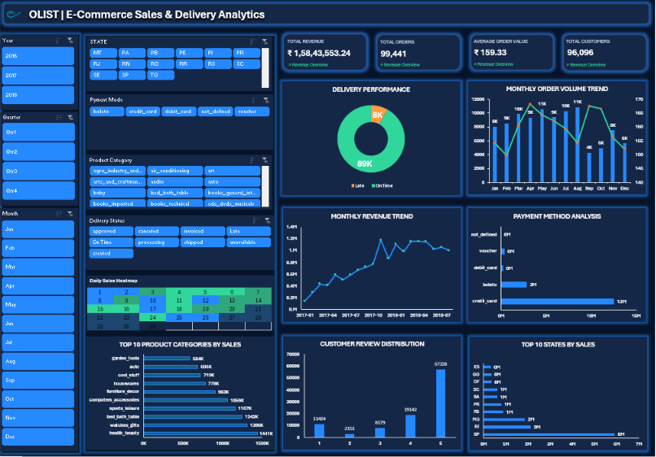

## Brazil E-Commerce Sales & Delivery Analytics


## Project Overview
An interactive Excel dashboard project built to analyze Brazilian e-commerce business performance, including sales trends, customer behavior, payment methods, product categories, and delivery performance.

The project uses Microsoft Excel, Power Pivot, DAX, PivotTables, and PivotCharts to transform raw e-commerce data into meaningful business insights.

## Business Objectives
- Analyze overall sales and order performance.
- Identify top-performing product categories and customer states.
- Understand monthly revenue and order volume trends.
- Evaluate payment method distribution.
- Monitor delivery performance and late deliveries.
- Analyze customer review ratings.

## Tools & Technologies
- Microsoft Excel
- Power Pivot
- DAX (Data Analysis Expressions)
- PivotTables & PivotCharts
- Excel Slicers & Timeline
- Conditional Formatting

## Key Performance Indicators (KPIs)

| KPI | Value |
|---|---:|
| Total Revenue | 15.84 Million |
| Total Orders | 99,441 |
| Unique Customers | 96,096 |
| Average Order Value | 159.33 |
| Late Delivery Rate | 8.11% |
| Average Delivery Time | 12.50 Days |
| Average Review Score | 4.09 |

## Dashboard Features
- Top 10 Product Categories by Sales
- Top 10 States by Sales
- Monthly Revenue Trend
- Monthly Order Volume Trend
- Delivery Performance Analysis
- Payment Method Analysis
- Customer Review Distribution
- Daily Sales Heatmap
- Interactive slicers and date filters

## Business Analysis
The dashboard enables users to explore sales, customer, payment, and delivery performance through interactive filters.

It helps identify revenue patterns, high-performing categories, regional sales distribution, customer satisfaction trends, and delivery performance.

## Project Structure

```text
Brazil-Ecommerce-Analytics/
│
├── Dashboard/
│   └── Olist_Ecommerce_Command_Center (Recovered).xlsx
│
└── README.md
```

## How to Use
1. Download the Excel workbook from the Dashboard folder.
2. Open it using Microsoft Excel.
3. Enable editing and refresh data if required.
4. Use the slicers and date filters to explore the dashboard.
5. Analyze business performance across different dimensions.

## Author
**Paras Kasrija**

Data Analytics | Excel | SQL | Python | Power BI

---

*This project was developed for hands-on practice in business intelligence, data analysis, and interactive dashboard development.*
